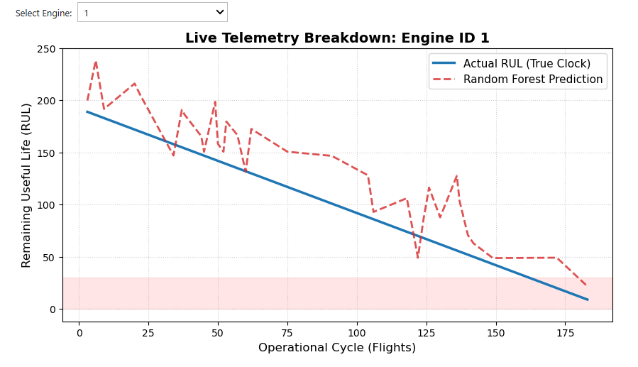
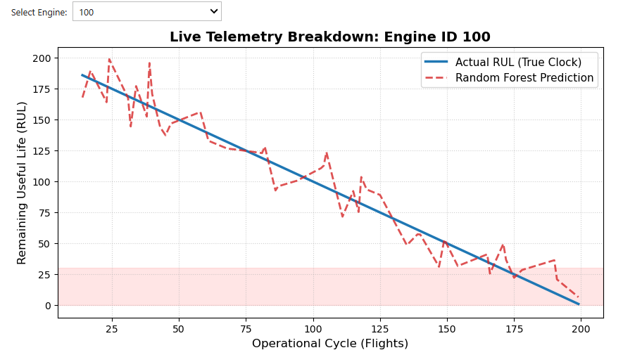

# Predicting Jet Engine Remaining Useful Life (RUL) Using Machine Learning

## Overview
Unplanned engine maintenance is expensive. It delays flights and can ground aircraft. In this project I predict Remaining Useful Life (RUL), the number of flight cycles an engine has left before it fails, using sensor data. Early warning signs of wear could help airline maintenance teams plan repairs ahead of time instead of reacting after something breaks.

## Dataset
- **Source:** [Kaggle: NASA Turbofan Jet Engine Dataset CSV](https://www.kaggle.com/datasets/azmaininqiadadeeb/nasa-turbofan-jet-engine-dataset-csv), based on NASA's C-MAPSS simulation (FD001 subset)
- **Size:** 20,631 rows x 27 columns (training file)
- **Contents:** 100 engines, 21 sensors, 3 operating settings, 1 target (RUL)
- **Note:** This is simulated run-to-failure data, so every engine runs until it fails.

## What I Did
1. **Cleaning and sanity checks:** I checked the data for missing values and duplicates and found none.
2. **Exploratory data analysis (EDA):** I looked at how sensor readings change over each engine's life and checked how they relate to RUL.
3. **Feature engineering:**
   - I dropped 8 sensor columns that never changed, since they gave the model no information.
   - The raw temperature sensors were jumpy (small, rapid ups and downs). I added a 3-cycle rolling average of the High-Pressure Compressor (HPC) outlet temperature to smooth out the noise while keeping the real wear trend.
   - I created `temperature_difference`, which is the HPC outlet temperature minus the Low-Pressure Compressor (LPC) outlet temperature. It captures the temperature gap between the engine's two compressors.
4. **Modeling:**
   - I started with a simple Linear Regression model as a baseline to compare against.
   - Then I trained a Random Forest Regressor (100 trees) to capture wear that doesn't follow a straight line.
   - The model uses 5 inputs: `cycle`, LPC outlet temperature, HPC outlet temperature, `temperature_difference`, and the 3-cycle rolling average of HPC outlet temperature.
   - I put the features on the same scale with `StandardScaler` (fitted on the training data only) so no single feature dominates. I used a random 80/20 train/test split.
5. **Evaluation:** I measured performance with MAE, RMSE, and R².

## Results

| Model | MAE (cycles) | RMSE (cycles) | R² |
|---|---|---|---|
| Linear Regression (Baseline) | 31.21 | 40.64 | 0.63 |
| Random Forest | 28.29 | 38.71 | 0.67 |

- **MAE:** The average prediction error, in flight cycles.
- **RMSE:** Similar to MAE, but it punishes big misses more heavily.
- **R²:** How much of the variation in RUL the model explains (1 is perfect).

## What I Found
- **Prediction accuracy:** On average, the Random Forest is off by about 28 flight cycles. That could give maintenance planners time to order parts and book hangar space before a component fails.
- **Sensors change as engines wear:** Temperatures and HPC static pressure rise as an engine wears out, while HPC outlet pressure drops.
- **Cycle count alone isn't enough:** Engine lifespans in this data range from 128 to 362 cycles, averaging about 206. Because of this, planning around cycle count alone wouldn't work well, and sensor readings are needed too.
- **Smoothing helped:** The 3-cycle rolling average of HPC outlet temperature had a stronger correlation with RUL (-0.77) than the raw sensor (-0.66). This suggests that filtering out noise helps the model pick up real wear.
- **Random Forest beat the baseline:** MAE dropped from 31.21 to 28.29 cycles. Random Forest combines many decision trees, and it seems to handle wear that doesn't follow a straight line better than Linear Regression.

## Interactive Graph
Pick an engine from the dropdown to compare true RUL (blue) against the Random Forest predictions (dashed line).

| Engine 1 | Engine 100 |
|---|---|
| 



 | 



 |

*The interactive dropdown only runs inside the Jupyter notebook. The images above are static previews.*

## Limitations
- **Data leakage in my test split:** I split the data by random rows, so rows from the same engine ended up in both the training and test sets. The model saw other rows from the same engine during training, which makes the test easier than real life. Splitting by whole engines would be a stricter test.
- **Simulated data:** The engines were simulated and run until failure, so the data is cleaner than real airline data, where engines are repaired or replaced before they fail. Results on a real fleet would likely be worse.
- I did not use the official separate test dataset (`test_FD001`).
- I only trained and tested on FD001, which has a single operating condition and failure mode.

## Project Structure
```
jet-engine-rul-prediction/
├── Real - Time Aircraft Engine Failure Prediction.ipynb   # Jupyter notebook
├── images/                                                # Graph screenshots
└── README.md                                              # Documentation
```
The dataset is not included. Download it from the Kaggle link above.

## How to Run
1. Download `train_FD001_descriptive.csv` from the Kaggle link and put it in the same folder as the notebook.
2. Install the libraries:
   ```
   pip install pandas numpy scikit-learn matplotlib seaborn ipywidgets
   ```
3. Open the notebook and click **Run All**.

## Tech Stack
- **Language:** Python
- **Data processing and feature engineering:** Pandas, NumPy
- **Machine learning:** Scikit-learn (Linear Regression, Random Forest Regressor)
- **Visualization and interactive graph:** Matplotlib, ipywidgets

## Author
**Mubarak Agboola**

Mechanical Engineering | Machine Learning and Data Analytics
