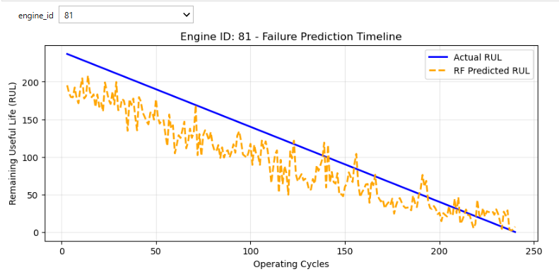
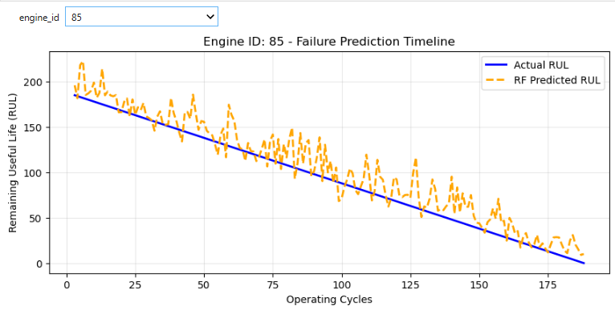
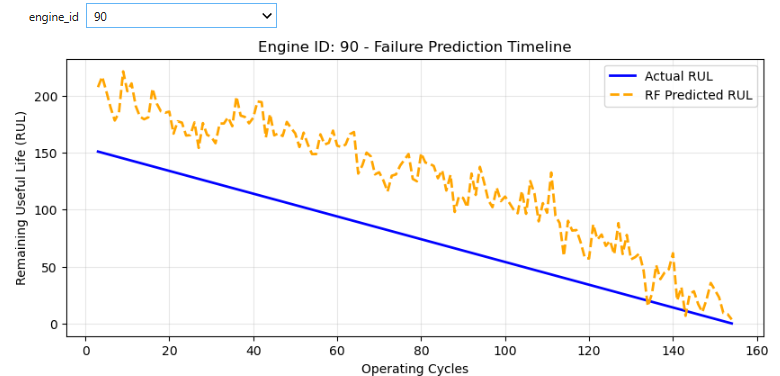
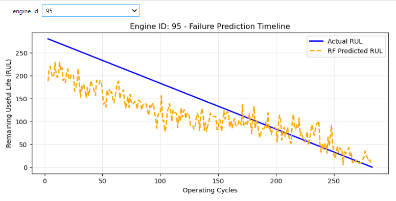
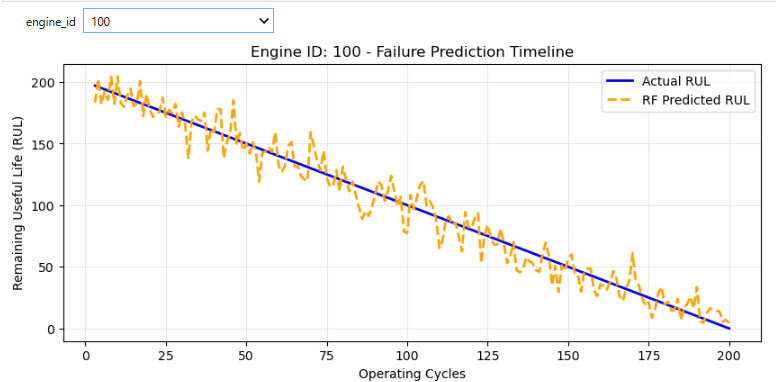

# Predicting Jet Engine Remaining Useful Life (RUL) Using Machine Learning

## Overview
Unplanned engine maintenance is expensive. It delays flights and can ground aircraft. In this project, I predict Remaining Useful Life (RUL) the number of flight cycles an engine has left before it fails using sensor data. Early warning signs of wear help airline maintenance teams plan repairs ahead of time instead of reacting after a component breaks.

## Dataset
- **Source:** [Kaggle: NASA Turbofan Jet Engine Dataset CSV](https://www.kaggle.com/datasets/azmaininqiadadeeb/nasa-turbofan-jet-engine-dataset-csv), based on NASA's C-MAPSS simulation (FD001 subset)
- **Size:** 20,631 rows x 27 columns (training file)
- **Contents:** 100 engines, 21 sensors, 3 operating settings, 1 target (RUL)
- **Note:** This is simulated run-to-failure data, so every engine runs until failure.

## What I Did
1. **Cleaning and sanity checks:** Checked the data for missing values and duplicates (found none).
2. **Exploratory data analysis (EDA):** Analyzed how sensor readings change over each engine's operational life and checked their relationships with RUL.
3. **Feature engineering:**
   - Dropped 8 constant sensor columns that provided no signal.
   - Added a 3-cycle rolling average of the High-Pressure Compressor (HPC) outlet temperature to smooth out sensor noise while keeping the wear trend intact.
   - Created `temperature_difference` (HPC outlet temperature minus Low-Pressure Compressor outlet temperature) to capture the thermal gap between compressors.
4. **Data Strategy (Leak Prevention):** Split the dataset on an **engine level** (80 engines for training, 20 engines for testing). This ensured entire engine lifecycles were isolated and prevented test data leakage during model evaluation.
5. **Modeling:**
   - Trained a Linear Regression model as a baseline.
   - Trained a Random Forest Regressor (100 trees) to capture non-linear wear dynamics.
   - Scaled features using `StandardScaler` fitted strictly on the training engines.
6. **Evaluation:** Evaluated performance across MAE, RMSE, and $R^2$.

## Results
Scores come from 20 engines held out of training (engines 81 to 100), so the models had never seen them.

| Model | MAE (cycles) | RMSE (cycles) | $R^2$ |
|---|---|---|---|
| Linear Regression (Baseline) | 43.78 | 54.85 | 0.49 |
| Random Forest | 38.23 | 51.49 | 0.55 |

- **MAE:** Average prediction error in flight cycles.
- **RMSE:** Punishes larger prediction errors more heavily.
- **$R^2$:** Variance explained by the model (1.0 is perfect).

## Key Takeaways
- **Honest accuracy:** On engines it had never seen, the Random Forest is typically off by about 38 flight cycles, about 5.5 cycles better than Linear Regression.
- **Why the engine split matters:** An earlier random-row split scored better (Random Forest MAE 28.29, R² 0.67) because rows from the same engine appeared in both training and test data. Splitting by whole engines gives the realistic score.
- **Accuracy varies by engine:** In the dashboard, some engines (such as 100) are tracked closely, while others (such as 81 and 82) show larger gaps, early in life or mid-life.

## Limitations
- Scores come from one split of 20 held-out engines. A different split would change them somewhat.
- The official test file (`test_FD001`) was not used.
- The data is simulated, not from real aircraft.
- Trained and tested on FD001 only (one operating condition, one fault type).

## Interactive Telemetry Dashboard
Pick any test engine from the interactive dropdown inside the notebook to view its actual RUL breakdown against the model's predictions in real-time, including a red 30-cycle critical maintenance window.

| Engine 81 | Engine 85 |
|---|---|
|  |  |

| Engine 90 | Engine 95 |
|---|---|
|  |  |

| Engine 100 |
|---|
|  |

*The interactive dropdown widget runs inside the Jupyter notebook environment. The screenshots above demonstrate test set evaluations.*

## Project Structure
```
jet-engine-rul-prediction/
├── Real - Time Aircraft Engine Failure Prediction.ipynb   # Jupyter notebook
├── images/                                                # Graph screenshots
└── README.md                                              # Documentation
```
The dataset is not included. Download it from the Kaggle link above.

## How to Run
1. Download `train_FD001_descriptive.csv` from the Kaggle link and put it in the same folder as the notebook.
2. Install the libraries:
   ```
   pip install pandas numpy scikit-learn matplotlib seaborn ipywidgets
   ```
3. Open the notebook and click **Run All**.

## Tech Stack
- **Language:** Python
- **Data processing and feature engineering:** Pandas, NumPy
- **Machine learning:** Scikit-learn (Linear Regression, Random Forest Regressor)
- **Visualization and interactive graph:** Matplotlib, ipywidgets

## Author
**Mubarak Agboola**

Mechanical Engineering | Machine Learning and Data Analytics
